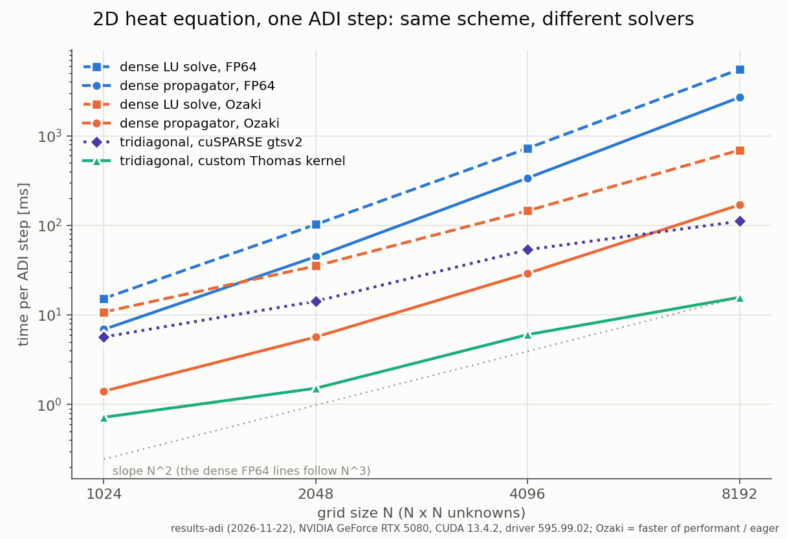

# vrc-ozaki-scheme-LT

コンシューマ GPU (GeForce RTX) で、CUDA 13.4 の cuBLAS に入った FP64 エミュレーション
(Ozaki scheme I / II) がどれだけ DGEMM と PDE 計算を速くするか、また精度が FP64 相当に
保たれるかを、Docker で分離した CUDA 12 環境との対照実験で定量評価するプロジェクト。
成果は VRChat 物理学集会の LT で発表する (スライドは [slides-jp/](slides-jp/))。

## 実験デザイン

### 条件

「CUDA 12 vs 13.4」の 2 条件だけだと、cuBLAS のバージョン差と Ozaki の効果が分離できない。
そこで CUDA 13.4 イメージを環境変数で native / emulated に切り替え、計 4 条件で測る。

| 条件 | イメージ | `CUBLAS_EMULATE_DOUBLE_PRECISION` | `CUBLAS_EMULATION_STRATEGY` | 役割 |
|---|---|---|---|---|
| `cuda12` | CUDA 12.9.1 | (なし) | (なし) | 対照 (旧環境) |
| `cuda13-native` | CUDA 13.4.2 | `0` | - | 同じ toolkit で Ozaki なし。バージョン差の切り分け |
| `cuda13-emu` | CUDA 13.4.2 | `1` | `performant` | cuBLAS が「得なら」エミュレーション |
| `cuda13-emu-eager` | CUDA 13.4.2 | `1` | `eager` | 可能な限りエミュレーション |

- **Ozaki の正味の効果** = `cuda13-emu*` vs `cuda13-native`
- **「CUDA を上げるだけで何が変わるか」** = `cuda13-emu*` vs `cuda12`

### CPU ベースライン (C++ / Eigen)

「GPU のエミュレーション FP64 は、ちゃんと書いた CPU の FP64 と比べてどうか」を見るため、CPU 側に 2 条件を置く。

| 条件 | 実装 | 役割 |
|---|---|---|
| `cpu-eigen` | C++17 + Eigen 3.4 のネイティブ GEMM (BLAS 委譲なし) + OpenMP、`-O3 -march=native` (AVX2 + FMA) | CPU 代表 (`--cpu-ref`) |
| `cpu-numpy` | NumPy → OpenBLAS 0.3.29 | 定番ライブラリの参照 |

- 入力は GPU 版と同じ関数・同じシードで Python が生成し、`.npy` で C++ (`cpp/cpu_bench`) に渡す。
  結果も `.npy` で戻し、精度評価は GPU と同じロジックで行うので、全条件が同じデータ・同じ物差しで比べられる
- CPU は P コア 6 + E コア 8 + LP-E コア 2 のハイブリッド構成。`OMP_PLACES=cores OMP_PROC_BIND=close` で
  コア ID 順に割り当て、**6 (P のみ) / 14 (P+E) / 16 (全コア)** スレッドを掃引し、最速の構成を代表値にする
  (全構成は report.md の「CPU thread sweep」に残る)
- PDE は Eigen 版のみ (ADI は Eigen GEMM、FTCS は OpenMP + SIMD のループ)。NumPy のスライス版ステンシルは
  CPU の実力を表さないので速度比較には使わない

### ワークロード

| ベンチ | 内容 | cuBLAS | 期待 |
|---|---|---|---|
| DGEMM | `C = A @ B`, N ∈ {2000, 4000, 8000, 16000} | `cublasDgemm` | エミュレーションで大幅高速化 |
| PDE `adi-gemm` | 2D 熱方程式, Peaceman–Rachford ADI (= 因子分解された Crank–Nicolson)。1 ステップ = `U ← M U M` の DGEMM 2 回 | 使う | 高速化 |
| PDE `ftcs-stencil` | 2D 熱方程式, 陽解法 5 点ステンシル (自前 CUDA カーネル) | 使わない | **変化なし** (負の対照) |

`ftcs-stencil` は「Ozaki は FP64 全般ではなく GEMM を速くする技術」であることを示す負の対照。
ステンシルや三重対角ソルバのような GEMM でない FP64 計算は、エミュレーションの恩恵を受けない。
`adi-gemm` の密な M は行列積を取り出すための模型で、同じ ADI を三重対角ソルバで解いた比較は下の「ADI のソルバ比較」にある。

### 精度評価

- **DGEMM**
  - NumPy (CPU) との比較: `max|C − C_np| / max|C_np|`, Frobenius 相対誤差
  - **厳密丸め参照との比較**: ランダムに選んだ要素について、誤差なし積 (Dekker TwoProduct) +
    `math.fsum` で正しく丸めた内積を計算し、`|c_ij − exact_ij| / (|A||B|)_ij` を単位丸め
    u = 2⁻⁵³ 単位で報告。NumPy 自身の誤差も同じ物差しで出るので「GPU エミュレーションが CPU の
    FP64 と同等か」を直接比べられる
  - 入力は Ozaki 論文の慣習に従い `A = (U(0,1) − 0.5)·exp(φ·N(0,1))`。φ を大きくすると
    指数のばらつきが増え、エミュレーションに必要なスライス数が増える (`--phi 0.5 2.0` などで掃引可)
- **PDE**: 初期条件を離散正弦固有モードの重ね合わせにしているので、差分スキームの離散厳密解が
  閉形式で得られる。これとの差は純粋に丸め誤差。参考として連続解との差 (離散化誤差) と NumPy 解との差も出す

### 評価指標

実行時間 (CUDA event、median/min/max/std)、TFLOPS、Speedup (median 時間比)、上記の誤差。

## 前提環境

開発機での確認状況 (2026-10-06):

- GPU: GeForce RTX 5080 16 GB (Blackwell, sm_120)
- Driver: 590.48.01 (CUDA 13.1 世代)。cuSOLVER の実験 (2026-11-22) は 595.99.02
- Docker 29.2 / Compose v5 / NVIDIA Container Toolkit 1.18.2
- CPU: Core Ultra 9 285H (NumPy 参照計算用)

### 注意点

1. **CUDA 12.4.1 ではなく 12.9.1 を対照にしている。** CUDA 12.4 は Blackwell (sm_120) 登場前で、
   cuBLAS/NVRTC がネイティブコードを持たない (PTX JIT 頼みか動かない)。RTX 50 系で
   12.4 を使うと「古い CUDA が遅い理由」に JIT が混ざり、比較が汚れる。
   Blackwell 以前の GPU で 12.4.1 を使いたい場合は `CUDA12_BASE_IMAGE=nvidia/cuda:12.4.1-devel-ubuntu22.04`。
2. **ドライバが 13.4 の要求 (R615+) より古い。** CUDA 13.x のマイナーバージョン互換で R580+ でも
   13.4 のユーザ空間ライブラリは動く想定だが、イメージの `NVIDIA_REQUIRE_CUDA=cuda>=13.4` で
   コンテナ起動が拒否されるため、`docker-compose.yml` で `NVIDIA_DISABLE_REQUIRE=true` にしている。
   ドライバを R615+ に上げたら `NVIDIA_DISABLE_REQUIRE=false` に戻すのが望ましい。
   さらに Container Toolkit の `cuda-compat-mode = "ldconfig"` によって、13.4 イメージ同梱の
   forward-compat libcuda (R615) がホストのドライバより優先されてしまう (GeForce では非サポート構成)。
   そこで `Dockerfile.cuda13` で `/usr/local/cuda-*/compat` を削除し、両条件ともホストの libcuda を使う
   (`env.json` の `libcuda_loaded` で確認できる)。
3. **エミュレーションは opt-in。** CUDA 13.4 にしただけでは DGEMM はネイティブ FP64 のまま。
   `CUBLAS_EMULATE_DOUBLE_PRECISION=1` が必要 (run_benchmarks.sh が条件ごとに設定)。
4. **CuPy は wheel を使い、コンテナ内 toolkit の cuBLAS をロードしていることを実行時に検証する。**
   `/proc/self/maps` から実際にロードされた `libcublas` のパスと `cublasGetVersion` を JSON に記録する。
   pip 由来の `nvidia-cublas-*` が入っていたらビルドを失敗させる。
   ソースビルドしたい場合は `CUPY_FROM_SOURCE=1 make build` (`pip install --no-binary cupy`、20 分以上かかる)。
5. N=16000 の DGEMM は入出力だけで 6 GB。エミュレーションのワークスペースと合わせて 16 GB を
   超える可能性があり、OOM になったケースは `status: failed` として記録され、スイープは続行する。

## 結果サマリ (RTX 5080, 2026-10-06)

詳細は [results/report.md](results/report.md)、[results-phi/report.md](results-phi/report.md)、
[results/nsys/kernels.md](results/nsys/kernels.md)。

| 項目 | 結果 |
|---|---|
| DGEMM (φ=0.5) | native ~0.82 TFLOPS → emu 5.5 / 9.0 / 13.4 / 15.6 TFLOPS (N=2000/4000/8000/16000)、**最大 19.2x** |
| cuda12 vs cuda13-native | 同等 (CUDA を上げるだけでは速くならない) |
| ADI-GEMM (PDE) | 4.2x / 7.5x / 11.5x / **15.9x** (N=1024..8192) |
| FTCS ステンシル (PDE) | 全条件 1.00x (GEMM でない FP64 計算は速くならない) |
| 精度 | emu の scaled err は 0.05–1.9u。native (1.6–86u)、NumPy (0.2–27u) より小さい |
| φ 依存性 (N=8000) | φ=0 → 4 で 17.1x → 12.4x。指数レンジが広いほど遅くなるが、精度は保たれる |
| 実行カーネル | エミュレーション時は常に **Ozaki-II** (`oz2_int8_dgemm` + INT8 Tensor Core `nvjet_sm120_biu_mma`)。native は `cutlass_80_tensorop_d884gemm` |
| performant vs eager | N=512 では performant が native を選ぶが、eager (Ozaki-II) の方が 2.4x 速い |
| CPU (C++/Eigen, 14 スレッド) | DGEMM 0.30–0.36 TFLOPS、OpenBLAS は 0.21–0.38 TFLOPS。Eigen 比で GPU native は **2.2–2.6x**、GPU Ozaki は **16–48x** (φ 掃引を含む) |
| CPU の PDE | ADI: GPU Ozaki が Eigen 比 11.7–39x。FTCS: GPU は Ozaki と無関係に 6.5–18x (メモリ帯域の差) |
| CPU の精度 | Eigen / OpenBLAS の scaled err は 0.2–0.9u (φ=0.5)、N=8000・φ=4 で 25–27u。Ozaki (0.05–1.9u) はどちらより小さい |
| cuSOLVER (math mode を API で指定) | LU 1.4–4.9x (N=2048–12000)、QR 最大 2.0x、eigh 最大 1.3x、Cholesky 1.0–1.1x。cuBLAS の環境変数では切り替わらない (2026-11-22、[results-cusolver/report.md](results-cusolver/report.md)) |
| ADI のソルバ比較 (N=8192、1 ステップ) | 三重対角ソルバ 15.7 ms、伝播行列 Ozaki 169.5 ms (FP64 2689 ms)、密な LU Ozaki 692.5 ms (FP64 5536 ms)。三重対角が Ozaki の 10.8x 速い (2026-11-22、[results-adi/report.md](results-adi/report.md)) |
| CPU のスレッド | 14 (P+E) が DGEMM / ADI で最速。16 (LP-E コアを含む) は Eigen で約 3 倍遅くなる。FTCS (メモリ律速) は 6 (P のみ) が最速 |

### カーネル確認 (Nsight Systems)

`make profile` (`profile_kernels.sh`) で、cuda13 イメージ同梱の nsys を使って DGEMM を NVTX 範囲内で
プロファイルし、カーネル名から実際の経路 (Ozaki-II / Ozaki-I / native FP64) を判定する。
cuda12 イメージには nsys が無いため対象外 (cuda13-native が同じ native 経路の代表)。

```bash
SIZES="512 2048 8000" PHIS="0.5 4" ./profile_kernels.sh   # -> results/nsys/kernels.md
```

`.nsys-rep` も残すので、Nsight Systems GUI でタイムラインを確認できる。

### φ 掃引

入力の指数レンジ φ を変えた DGEMM 比較は `make phi-sweep` (`results-phi/`)。
φ=0 は一様乱数 `U(-0.5, 0.5)`、φ=4 では要素の大きさが `exp(±4σ)` 程度に広がる。

### Fortran の既存バイナリ + NVBLAS (drop-in)

「既存の Fortran コードを書き換えずに Ozaki の恩恵を受けられるか」を確かめる追加実験 (`make fortran-bench`、
[results-fortran/dgemm.txt](results-fortran/dgemm.txt))。`external dgemm` を呼ぶだけの Fortran
(`fortran/dgemm_bench.f90`) を OpenBLAS にリンクして 1 回だけビルドし、同じバイナリを次の 3 条件で動かす。

| 条件 | 実行方法 |
|---|---|
| `fortran-openblas` | そのまま (OpenBLAS、14 スレッド) |
| `fortran-nvblas-native` | `LD_PRELOAD=libnvblas.so.13` + `CUBLAS_EMULATE_DOUBLE_PRECISION=0` |
| `fortran-nvblas-emu` | `LD_PRELOAD=libnvblas.so.13` + `CUBLAS_EMULATE_DOUBLE_PRECISION=1` |

NVBLAS は呼び出しのたびに A, B を GPU に送り、C を戻すので、時間は PCIe 転送込みの end-to-end になる。
精度は real128 の内積を参照にしたサンプル比較 (`benchmark_dgemm.py` と同じ scaled err)。

| N (φ=0.5) | OpenBLAS | NVBLAS native | NVBLAS emu | emu / OpenBLAS | emu / native |
|---:|---:|---:|---:|---:|---:|
| 4000 | 0.391 s | 0.238 s | 0.099 s | 4.0x | 2.4x |
| 8000 | 2.537 s | 1.530 s | 0.361 s | 7.0x | 4.2x |
| 16000 | 23.40 s | 11.75 s | 2.258 s | **10.4x** | 5.2x |

- NVBLAS 経由でもエミュレーションの環境変数が効き、nsys で Ozaki-II (`oz2_int8_dgemm`) を確認した。
  N=8000 のカーネル時間は 71.4 ms で、CuPy 経路 (71.7 ms) と同じ
- 誤差は emu が 0.026–0.080u、native が 0.47–1.70u、OpenBLAS が 0.21–0.34u
- このマシンの GPU は PCIe x4 接続 (実効 5–6 GB/s) で、N=8000 では end-to-end の約 7 割が転送。
  GPU 常駐の CuPy (OpenBLAS 比 44x) には届かない
- `NVBLAS_AUTOPIN_MEM_ENABLED` は emu では逆効果 (N=8000 で 0.53 s → なしで 0.36 s)。既定ではオフ
- **NVBLAS は無言で失敗する**: `NVBLAS_TILE_DIM 16384` (16 GB の GPU) では `cublasXtDgemm` が
  `CUBLAS_STATUS_ALLOC_FAILED` で失敗するが、`dgemm_` は C に触れずに戻り、エラーは NVBLAS のログにしか出ない。
  `run_fortran_benchmarks.sh` は実行ごとにログを確認し、失敗を `FAILED` 行として記録する

### cuSOLVER (LU・Cholesky・QR・固有値)

「密な連立方程式や固有値問題も Ozaki で速くなるか」を確かめる追加実験 (`make cusolver-bench`、
[results-cusolver/report.md](results-cusolver/report.md))。

**cuBLAS の環境変数は cuSOLVER に届かない。** cuSOLVER のドキュメント (Floating Point Emulation の節) のとおり、
`CUBLAS_EMULATE_DOUBLE_PRECISION` は cuSOLVER の中の cuBLAS ハンドルには効かず、
cuSOLVER のハンドルごとに `cusolverDnSetMathMode(handle, CUSOLVER_FP64_EMULATED_FIXEDPOINT_MATH)` と
`cusolverDnSetEmulationStrategy` で有効にする。CuPy 14.2.0 にはこの API がないので、
`src/benchmark_cusolver.py` は CuPy の cuSOLVER ハンドルに ctypes で設定し、同じプロセスの中で次の 4 つを切り替える。

| モード | math mode | 戦略 |
|---|---|---|
| `default` | `CUSOLVER_DEFAULT_MATH` | - (ネイティブ FP64) |
| `emu-performant` | `CUSOLVER_FP64_EMULATED_FIXEDPOINT_MATH` | `performant` |
| `emu-eager` | `CUSOLVER_FP64_EMULATED_FIXEDPOINT_MATH` | `eager` |
| `default-again` | `CUSOLVER_DEFAULT_MATH` | - (最後に戻せることの確認) |

- 対象: `cupy.linalg.solve` (getrf + getrs)、`cholesky` (potrf)、`qr` (geqrf + orgqr)、`eigh` (Xsyevd)。
  対照として CuPy の cuBLAS ハンドルでの `A @ A` も測る (cuSOLVER の math mode では変わらないはず)
- 同じベンチを `cuda13-native` と `cuda13-emu` で流し、cuBLAS の環境変数が cuSOLVER の時間を変えないことを確かめる
- `src/benchmark_blas3.py`: ブロック分解の部品になる cuBLAS の GEMM / SYRK / TRSM / 幅 k の GEMM (P Pᵀ) を、
  環境変数の 3 条件 (`cuda13-native` / `cuda13-emu` / `cuda13-emu-eager`) で測る
- nsys の `nvtx_kern_sum` で、NVTX 範囲 (ルーチン × モード、演算 × 条件) ごとに実際に動いたカーネルを集計する
- 精度は後退誤差型の残差 (LU: `‖b − Ax‖∞ / (‖A‖∞‖x‖∞ + ‖b‖∞)`、Cholesky: `‖LLᵀ − S‖F / ‖S‖F` など) を GPU の FP64 で計算する。
  残差の計算自体にも丸め誤差があるので、比べるのは同じ条件の中のモードどうしだけ

結果 (RTX 5080、ドライバ 595.99.02、2026-11-22)。倍率は default の時間を、emu-performant と emu-eager の速いほうで割ったもの。

| ルーチン | N=2048 | 4096 | 8192 | 12000 |
|---|---:|---:|---:|---:|
| LU (solve) | 1.44x | 2.01x | 3.49x | **4.94x** |
| QR | 1.12x | 1.35x | 1.97x | - |
| eigh | 1.11x | 1.24x | 1.33x | - |
| Cholesky | 1.11x | 1.09x | 1.03x | 1.04x |

- 精度は default と同じ桁 (LU の後退誤差は 8.9–54u、Cholesky の再構成誤差は 3 桁まで一致、QR はむしろ小さい)
- `cuda13-emu` (cuBLAS の環境変数あり) の default の時間は `cuda13-native` の 0.99–1.00 倍。CuPy のハンドルの GEMM だけが 7.4–21.7x 速くなる
- `default-again` は最初の `default` と 0.7% 以内で一致した (切り替えは元に戻せる)。繰り返しの相対標準偏差は最大 0.7%
- nsys (N=8192): LU は default で時間の 89% が FP64 GEMM。emu ではそこが Ozaki-II (`oz2_int8_dgemm` + INT8 `nvjet_*_biu_mma`) になる。
  Cholesky は時間の約 8 割が FP64 の SYRK (`d884syrk`) で、どのモードでも変わらない。
  QR は performant だと行列積の 75% が FP64 のままで、eager なら 68% が Ozaki-II。eigh は 53% が行列積以外 (三重対角化など)
- cuBLAS 単体 (N=8192、performant): GEMM 17.1x、TRSM 4.6x、SYRK 2.9x (時間の 80% は FP64 の SYRK カーネルのまま)。
  幅 k の GEMM (N × k の P で P Pᵀ) は k ≤ 256 で FP64 のまま (1.00x)、k = 512 で 7.6x、2048 で 13.7x。eager なら k = 256 でも 4.7x
- 10 月の予備測定 (cuBLAS の環境変数だけで切り替え) で「cuSOLVER は速くならない」としたのは、切り替え方の誤り

### ADI のソルバ比較 (三重対角ソルバ / 密な LU / 伝播行列)

`adi-gemm` の密な伝播行列 M は、行列積を取り出すための模型で、実際の陰解法は三重対角ソルバで解く (1 ステップ O(N²))。
「三重対角ソルバで解けばいいのでは」に実測で答えるため、**同じ ADI (同じ格子、時間刻み、初期条件、離散厳密解)** を
ソルバだけ替えて測る (`make adi-bench`、[results-adi/report.md](results-adi/report.md))。

| ソルバ | 1 ステップの中身 | 計算量 |
|---|---|---|
| `tridiag-thomas` | 帯行列の積 + Thomas 法 (自前の CUDA カーネル、格子の 1 線に 1 スレッド) | O(N²) |
| `tridiag-cusparse` / `-pivot` | 帯行列の積 + cuSPARSE `gtsv2_nopivot` / `gtsv2` | O(N²) |
| `propagator` | `U ← M U M` (GEMM 2 回)。M は固有分解の式から作る (`adi-gemm` と同じ) | O(N³) |
| `propagator-lu` | 同上。ただし M を GPU 上の getrf + getrs (右辺 N 本) で作る | O(N³) |
| `dense-lu` | A = I − aL と B = I + aL を一般の密行列として扱う。getrf は最初に 1 回、毎ステップ GEMM 2 回 + getrs 2 回 | O(N³) |

- どれも厳密な算術では `U ← M U M` に一致する。誤差は同じ離散厳密解と比べる
- エミュレーションは条件の環境変数に従う。cuBLAS は環境変数を自分で読み、cuSOLVER には `src/benchmark_adi.py` が同じ設定の math mode を入れる
- 三重対角ソルバは cuBLAS も cuSOLVER も呼ばないので、条件間の比は対照になる
- 配列は C 順のまま。転置は直前の積に畳み込み (転置した GEMM のオペランド、または結果を転置して書くカーネル)、転置のコピーはしない
- `tridiag-thomas` は素直な実装で、チューニングはしていない (係数が全線で共通なことだけ使っている)



結果 (RTX 5080、ドライバ 595.99.02、2026-11-22)。1 ステップの時間 [ms]、20 ステップ × 3 回の中央値。Ozaki は `cuda13-emu` と `cuda13-emu-eager` の速いほう。

| N | 三重対角 (Thomas) | 三重対角 (cuSPARSE の速いほう) | 伝播行列 FP64 | 伝播行列 Ozaki | 密な LU FP64 | 密な LU Ozaki |
|---:|---:|---:|---:|---:|---:|---:|
| 1024 | 0.719 | 5.675 | 6.89 | 1.406 | 15.29 | 10.77 |
| 2048 | 1.517 | 14.21 | 44.71 | 5.667 | 102.3 | 35.25 |
| 4096 | 6.029 | 53.47 | 338.2 | 29.16 | 726.1 | 145.5 |
| 8192 | **15.71** | 111.2 | 2689 | **169.5** | 5536 | 692.5 |

- **三重対角ソルバ (自前の Thomas 法) は、伝播行列の Ozaki より 2.0x (N=1024) 〜 10.8x (N=8192) 速い。** FP64 の伝播行列とは 9.6x 〜 171x。
  N=8192 では Ozaki が密行列との差を 171x から 10.8x に縮めるが、O(N²) と O(N³) の差は埋まらず、N とともに開く
- 伝播行列の Ozaki は、cuSPARSE の三重対角ソルバより N ≤ 4096 で 1.8–4.0x 速く、N=8192 で 1.5x 遅い。FP64 のままだと N=8192 で cuSPARSE の 24x 遅い
- 密な LU で毎ステップ解くと、Ozaki で 1.4x 〜 8.0x 速くなる (N=8192 で 5536 → 692.5 ms) が、三重対角ソルバより 15–44x 遅い。
  内訳 (N=8192、eager): GEMM 2 回が 14.8x、getrs 2 回 (右辺 N 本) が 5.3x
- **三重対角行列を密行列として getrf しても Ozaki は効かない** (N=8192 で 497.6 → 473.3 ms、1.05x。乱数行列では 3.5x)。
  nsys で見ると、エミュレーションの経路には入るが、カーネル時間の 77–78% が FP64 に戻る `cublasLt_imma_emu::...d884gemm` だった。
  右辺が三重対角の getrs (M を作るとき) も同じで 86–88% が FP64。要素の桁のばらつきが極端に大きい (ゼロと、指数的に減衰する要素) ためと推定している (未確認)
- 丸め誤差 (離散厳密解との相対誤差、N=8192): A で解くソルバは 3.4e-12 〜 2.9e-11 (三重対角 1.7e-11、密な LU 1.7e-11、LU で作った M 2.9e-11)。
  A の条件数 (約 1.3 万) が効く。固有分解の式から作った M は FP64 2.0e-13、Ozaki 7.3e-15 だが、これは M を解析的に作れるこの問題に特有。
  どれも離散化誤差 (7.5e-6) よりずっと小さい
- 対照: 三重対角ソルバの時間は 3 条件で 0.98–1.01x。例外は `tridiag-cusparse` の N=2048 で、エミュレーション条件の通し実行では 0.80x (17.7 ms) になった。
  単独で流すと両条件とも 14.2 ms で、`propagator-lu` (エミュレーションあり) を同じプロセスで先に動かしたときだけ再現する (原因は未特定、この切り分けの出力はリポジトリに入れていない)
- nsys のプロファイルは、準備 (getrf / getrs) を NVTX の範囲で囲む変更のあとに取り直した。`adi.json` はその変更の前の実行のもの (計時の経路は同じ)

## 使い方

```bash
make build        # イメージのビルド
make env-check    # GPU / CUDA / cuBLAS / エミュレーション設定の確認
make quick        # 小サイズでの動作確認 (results-quick/)
make bench        # 本番 (results/)。DGEMM + PDE、全 4 条件、最後にレポート生成
make phi-sweep    # φ = 0, 0.5, 1, 2, 4 の DGEMM 比較 (results-phi/)
make profile      # nsys で実行カーネルを確認 (results/nsys/)
make cpu-quick    # C++/Eigen + NumPy の CPU ベースラインを小サイズで動作確認 (results-quick/)
make cpu-bench    # CPU ベースライン本番 (results/)。DGEMM + PDE、スレッド 6/14/16
make cpu-phi-sweep  # CPU の φ 掃引 (results-phi/)。THREADS=14 のようにスレッド数を指定
make fortran-quick  # Fortran + NVBLAS の drop-in を小サイズで動作確認 (results-quick/fortran/)
make fortran-bench  # Fortran + NVBLAS の drop-in 本番 (results-fortran/)。先に make build が必要
make cusolver-quick # cuSOLVER の math mode と cuBLAS Level-3 の実験を小サイズで動作確認 (results-quick/cusolver/)
make cusolver-bench # cuSOLVER (LU・Cholesky・QR・固有値) と cuBLAS Level-3、nsys まで (results-cusolver/)
make adi-quick      # ADI のソルバ比較を小サイズで動作確認 (results-quick/adi/)
make adi-bench      # ADI を伝播行列 / 密な LU / 三重対角ソルバで比較、nsys まで (results-adi/)
make analyze      # results/ と results-phi/ から図と report.md を再生成
make slides       # スライドを http://localhost:8000 で表示 (python3 の http.server)
make fonts        # スライド (slides-jp/index.html) で使う字にフォントを絞り直す (uv が必要)
```

スライドの表示や PDF 出力は [slides-jp/README.md](slides-jp/README.md)。

GPU と CPU のベンチは**同時に走らせない** (どちらもホスト CPU を使うため)。

`run_benchmarks.sh` は環境変数で調整できる:

```bash
CONDITIONS="cuda13-native cuda13-emu" ./run_benchmarks.sh        # 条件を絞る
RESULTS_DIR=results-foo ./run_benchmarks.sh                        # 出力先を変える
DGEMM_ARGS="--phi 0.5 2.0 --repeats 10" SKIP_PDE=1 ./run_benchmarks.sh
PDE_ARGS="--sizes 2048 4096 --adi-steps 50" SKIP_DGEMM=1 ./run_benchmarks.sh
```

各スクリプトは単体でも実行できる (`python src/benchmark_dgemm.py --help`)。

## 出力

```text
results/
├── <condition>/
│   ├── env.json      # 環境情報 (CUDA / cuBLAS バージョン、ロードされた libcublas、エミュレーション設定)
│   ├── dgemm.json    # DGEMM の生データ (各 repeat の時間、誤差)
│   ├── pde.json      # PDE の生データ
│   └── *.log
├── figures/
│   ├── dgemm_tflops.png
│   ├── dgemm_speedup.png
│   ├── dgemm_error.png
│   ├── pde_time_per_step.png
│   ├── pde_speedup.png
│   ├── dgemm_speedup_vs_cpu.png   # cpu-eigen 基準の speedup (CPU 結果がある場合)
│   └── pde_speedup_vs_cpu.png
├── nsys/
│   ├── <condition>/  # *.nsys-rep と NVTX 範囲内のカーネル集計 CSV
│   ├── kernels.json
│   └── kernels.md    # 条件・N・φ ごとの実行経路と上位カーネル
└── report.md         # 表と図をまとめたレポート

results-phi/          # φ 掃引 (図に dgemm_phi_tflops.png / dgemm_phi_error.png が加わる)

results-fortran/
├── dgemm.txt         # Fortran drop-in の RESULT 行 (条件・タイルごと) と nsys の判定 (NSYS 行)
└── nsys/fortran-nvblas-emu/  # *.nsys-rep とカーネル / memcpy の集計 CSV

results-cusolver/
├── <condition>/      # env.json、blas3.json、cusolver.json (cuda13-native / cuda13-emu)、*.log
├── nsys/             # *.nsys-rep と NVTX 範囲ごとのカーネル集計 CSV (*_nvtx_kern_sum.csv)
└── report.md         # 時間・精度・環境変数の確認・Level-3・カーネルの表

results-adi/
├── <condition>/      # env.json、adi.json、*.log
├── nsys/             # *.nsys-rep と NVTX 範囲 (ソルバ) ごとのカーネル集計 CSV
├── figures/adi_time_per_step.png   # ソルバごとの 1 ステップの時間 (両対数)
└── report.md         # ソルバ × 条件の時間、丸め誤差、LU の内訳、カーネルの表
```

NumPy の参照解は `cache/` にキャッシュされ、全条件で同じものを使う (NumPy は全イメージで同一バージョンに固定)。

## ディレクトリ構成

```text
.
├── docker/
│   ├── Dockerfile.cuda12      # CUDA 12.9.1 + CuPy (cupy-cuda12x)
│   ├── Dockerfile.cuda13      # CUDA 13.4.2 + CuPy (cupy-cuda13x)
│   ├── Dockerfile.cpu         # Ubuntu 24.04 + g++ 13 + Eigen 3.4 + CMake
│   ├── Dockerfile.fortran     # cuda13 イメージ + gfortran 13 + OpenBLAS (NVBLAS は CUDA 同梱)
│   ├── requirements.txt       # NumPy / matplotlib (全イメージ共通で固定)
│   └── requirements-cpu.txt   # + threadpoolctl (OpenBLAS のスレッド数制御)
├── docker-compose.yml
├── cpp/
│   ├── cpu_bench.cpp          # C++/Eigen の DGEMM / ADI / FTCS (サブコマンド)
│   ├── npy.hpp                # 2D float64 .npy の読み書き
│   └── CMakeLists.txt
├── fortran/
│   └── dgemm_bench.f90        # BLAS の dgemm を呼ぶだけの Fortran ドライバ (real128 で精度確認)
├── src/
│   ├── common.py              # 環境情報の収集、CUDA event タイマー
│   ├── benchmark_dgemm.py     # DGEMM ベンチマーク
│   ├── benchmark_pde.py       # 2D 熱方程式ベンチマーク (ADI-GEMM / FTCS ステンシル)
│   ├── analyze_results.py     # 集計、PNG 出力、Markdown レポート生成
│   ├── profile_dgemm.py       # nsys 用の DGEMM ドライバ (NVTX 範囲付き)
│   ├── summarize_nsys.py      # nsys のカーネル集計から実行経路を判定
│   ├── benchmark_cusolver.py  # cuSOLVER の math mode を ctypes で切り替えて LU / Cholesky / QR / eigh を測る
│   ├── benchmark_blas3.py     # cuBLAS の GEMM / SYRK / TRSM / 幅 k の GEMM
│   ├── report_cusolver.py     # results-cusolver/report.md の生成
│   ├── benchmark_adi.py       # 同じ ADI を伝播行列 / 密な LU / 三重対角ソルバで解く
│   ├── report_adi.py          # results-adi/report.md の生成
│   └── benchmark_cpu.py       # CPU ベースライン (C++/Eigen と NumPy) のオーケストレーション
├── scripts/
│   ├── conditions.sh          # 実験条件の定義 (run_benchmarks.sh / profile_kernels.sh が共有)
│   └── subset-fonts.sh        # スライドのフォントを使う字だけに絞る (make fonts)
├── run_benchmarks.sh          # 全条件・全ベンチを一括実行
├── profile_kernels.sh         # nsys で実行カーネルを確認
├── run_cpu_benchmarks.sh      # CPU ベースラインを一括実行
├── run_fortran_benchmarks.sh  # Fortran + NVBLAS の drop-in 実験を一括実行
├── run_cusolver_benchmarks.sh # cuSOLVER と cuBLAS Level-3 の実験を一括実行
├── run_adi_benchmarks.sh      # ADI のソルバ比較を一括実行
├── Makefile
└── slides-jp/                 # 発表スライド (reveal.js、lt-slide-template の水彩の地図帳テーマ)
```

## 参考

- [cuBLAS documentation — Floating Point Emulation](https://docs.nvidia.com/cuda/cublas/)
- [CUDA Toolkit 13.4 Release Notes](https://docs.nvidia.com/cuda/cuda-toolkit-release-notes/index.html)
- Ozaki, Uchino, Imamura, "Ozaki Scheme II: A GEMM-oriented emulation of floating-point matrix multiplication using an integer modular technique" (2025)
